<div align="center">

# Mac-Android Family
### Universal Phone & Tablet Graphics Digitizer for macOS

[](https://github.com/anant-rajj/mac-android-family)
[](https://github.com/anant-rajj/mac-android-family)
[](https://github.com/anant-rajj/mac-android-family)
[](https://github.com/anant-rajj/mac-android-family)
[](LICENSE)

<br/>

**Transform ANY Android smartphone, tablet, or Apple iPad into a high-precision, pressure-sensitive graphics tablet for Mac.**  
Engineered with sub-millisecond event synthesis, native Apple Quartz tablet taps, and zero-overhead binary streaming.

<br/>



</div>

---

## 📑 Table of Contents

- [Universal Device & Stylus Support](#-universal-device--stylus-support)
- [System Architecture](#-system-architecture)
- [Core Capabilities](#-core-capabilities)
- [Data Pipeline](#-data-pipeline)
- [How to Download](#-how-to-download)
- [How to Operate](#-how-to-operate)
- [Command-Line Interface](#-command-line-interface)
- [How to Uninstall](#-how-to-uninstall)
- [Technical Specifications](#-technical-specifications)
- [Repository Structure](#-repository-structure)
- [License](#-license)

---

## 📱 Universal Device & Stylus Support

Mac-Android Family is built from the ground up to support **any mobile phone or tablet** running a modern web browser or Android runtime:

| Category | Supported Hardware | Input Capabilities | Connection Mode |
| :--- | :--- | :--- | :--- |
| **Samsung Galaxy Devices** | Galaxy S21/S22/S23/S24 Ultra, Galaxy Note series, Z Fold series | S Pen (240Hz EMR, 4,096 Pressure Steps, Dual Tilt) | Browser / Native App |
| **Android Tablets** | Galaxy Tab S7/S8/S9/S10, Xiaomi Pad, OnePlus Pad, Lenovo Tab | S Pen, Xiaomi Smart Pen, USI Stylus, Capacitive Pen | Browser / Native App |
| **Apple iPad & iPad Pro** | iPad Pro, iPad Air, iPad mini, Standard iPad | Apple Pencil 1 / 2 / Pro, Tilt, Pressure, Touch | Safari Browser (Zero-Install) |
| **Android Smartphones** | Google Pixel, Xiaomi, OnePlus, Motorola, Nothing Phone, etc. | Active Stylus, Capacitive Pen, or Finger Touch Drawing | Chrome / Web Browser |

---

## 🏛️ System Architecture

Mac-Android Family bridges mobile touchscreens and digitizers directly into macOS WindowServer. By intercepting raw hardware coordinates, the engine routes events through a high-frequency low-pass filter and synthesizes standard HID tablet events directly into the macOS operating system:

```
[ Any Mobile Device (Phone / Tablet / iPad) ]
         │  (S Pen / Apple Pencil / Stylus / Touch)
         ▼
[ 1-Euro Adaptive Low-Pass Filter ]
         │  (Jitter Cancellation & Smoothing)
         ▼
[ 12-Byte Turbo Binary Frame (0xFACE) ]
         │  (Zero-Copy WebSocket / UDP Loopback)
         ▼
[ Swift Native Daemon (family-daemon) ]
         │  (Isolated CGEventSource State)
         ▼
[ macOS Quartz Event Tap (kCGEventTabletPointer) ]
         │  (Sub-pixel Cursor, Pressure & Tilt)
         ▼
[ Creative Apps: Krita • Photoshop • Blender • Affinity ]
```

---

## ✨ Core Capabilities

- **Universal Multi-Input Detection**: Intelligently switches between Active Styluses (EMR / Apple Pencil), Capacitive Pens, and Touch input modes.
- **240Hz Coalesced Event Extraction**: Leverages `getCoalescedEvents()` across browsers to capture micro-movements between standard screen refresh ticks.
- **4,096 Hardware Pressure Steps**: Passes true pressure values directly to macOS `kCGEventTabletPointer` attributes.
- **Dynamic Touch Pressure Emulation**: When using a capacitive stylus or finger on devices without pressure sensors, the engine calculates smooth, dynamic stroke weighting based on speed and contact area.
- **Dual-Axis Tilt Tracking**: Full support for stylus altitude and azimuth angle tracking (-60° to +60°).
- **Sub-Millisecond 1-Euro Filter**: An adaptive cutoff filter ($f_c = f_{c,\min} + \beta \cdot |\dot{x}|$) that stabilizes stationary precision work while remaining instant during fast sketching.
- **Turbo 12-Byte Wire Format**: Packed binary format over WebSockets with `TCP_NODELAY`, bypassing heavy JSON parsers.
- **Isolated Quartz Event Tap**: Uses a private `CGEventSource` state to prevent modifier key latching bugs across macOS.
- **Zero-Install Web Portal**: Instant pairing via any mobile browser (Chrome, Safari, Samsung Internet, Edge, Firefox).

---

## ⚡ Data Pipeline

The pipeline processes input packets from physical glass contact to macOS brush strokes in under 1.2 milliseconds:

<br/>



<br/>

| Stage | Component | Latency Overhead | Description |
| :--- | :--- | :--- | :--- |
| **Stage 1** | Mobile Screen Ingress | ~0.2 ms | Coalesced hardware pointer polling on phone or tablet |
| **Stage 2** | 1-Euro Adaptive Filter | ~0.1 ms | Dynamic cutoff frequency smoothing and jitter removal |
| **Stage 3** | Turbo Binary Frame | ~0.1 ms | Packed 12-byte struct with `0xFACE` validation header |
| **Stage 4** | WebSocket / UDP Bridge | ~0.4 ms | Kernel socket streaming with disabled buffering |
| **Stage 5** | Quartz Event Tap | ~0.3 ms | Direct injection into macOS WindowServer event tap |
| **Total** | **End-to-End** | **&lt; 1.2 ms** | **Zero perceptible lag for professional illustration** |

---

## 📥 How to Download

### Option 1: Git Clone (Recommended)

Open Terminal on your Mac and clone the repository:

```bash
git clone https://github.com/anant-rajj/mac-android-family.git
cd mac-android-family
```

### Option 2: Direct Archive Download

Download and unpack the latest repository package:

```bash
curl -L -o mac-android-family.zip https://github.com/anant-rajj/mac-android-family/archive/refs/heads/main.zip
unzip mac-android-family.zip
cd mac-android-family-main
```

### Prerequisites Check

The project runs on standard macOS developer tooling:
- **macOS**: Version 12.0 or later (Apple Silicon M-series or Intel).
- **Swift Toolchain**: Included with Xcode or Command Line Tools (`xcode-select --install`).
- **Python**: Version 3.8+ (pre-installed on macOS).
- **Python Dependencies**:
  ```bash
  pip3 install websockets qrcode
  ```

---

## 🚀 How to Operate

Follow these steps to connect your device and start drawing:

<br/>



<br/>

### Step 1: Launch the System

Inside the project directory, run the primary launcher:

```bash
./start.sh start
```

*(Or use the convenience alias `./family start`)*.

The system will:
1. Verify and compile the native Swift daemon in release mode if needed.
2. Spin up the native Quartz tablet daemon (`family-daemon`).
3. Start the low-latency WebSocket fast-path bridge and static canvas server.
4. Display your local connection URL and render a scannable terminal ASCII QR code.

### Step 2: Connect Your Device (Phone, Tablet, or iPad)

1. Ensure your phone or tablet is on the same local Wi-Fi network as your Mac.
2. Open any web browser on your device (**Safari** on iPad/iPhone, **Chrome** or **Samsung Internet** on Android).
3. Scan the terminal QR code with your camera, or navigate to:
   ```
   http://<mac-ip-address>:8080
   ```
4. The canvas interface opens instantly with an active link badge. Tap **Fullscreen** for an edge-to-edge drawing canvas.

> [!TIP]
> **Optional Wired USB Tethering**: On Android, connect a USB cable and run:
> ```bash
> adb forward tcp:8080 tcp:8080
> adb forward tcp:9877 tcp:9877
> ```
> Then open `http://localhost:8080` on your mobile browser for zero-wireless interference.

### Step 3: Draw in Any Creative Suite

Touch your stylus or finger to your mobile screen. Your Mac cursor tracks your hand movements across the display:
- **Krita**: Full pressure sensitivity, tilt brush dynamics, and stroke stabilization.
- **Adobe Photoshop**: Natural brush stroke weight, opacity, and angle shading.
- **Blender**: 2D Grease Pencil sketching and 3D surface sculpting.
- **Affinity Designer / Photo**: Vector tablet stroke styling and pressure curves.

---

## 💻 Command-Line Interface

The repository provides an interactive CLI tool (`./start.sh` or `./family`) to control all operations:

```
  __  __                  _              _           _     _ 
 |  \/  |                / \   _ __   __| |_ __ ___ (_) __| |
 | |\/| | _____ ____    / _ \ | '_ \ / _` | '__/ _ \| |/ _` |
 | |  | |/ _ \ \/ /\ \ / ___ \| | | | (_| | | | (_) | | (_| |
 |_|  |_|\___/\_/  \_//_/   \_\_| |_|\__,_|_|  \___/|_|\__,_|
   Universal Phone & Tablet Graphics Digitizer • macOS Engine
```

### Command Reference

| Command | Syntax | Description |
| :--- | :--- | :--- |
| **Help Menu** | `./start.sh help` | Prints the complete interactive guide and available commands |
| **Start Services** | `./start.sh start` | Compiles binaries if needed, starts daemon and bridge, prints QR code |
| **Stop Services** | `./start.sh stop` | Gracefully shuts down daemon and bridge, releases ports 8080, 9876, 9877 |
| **Status Audit** | `./start.sh status` | Inspects process health, PIDs, and active network port listeners |
| **Show QR** | `./start.sh qr` | Renders terminal ASCII QR code and pairing link |
| **Compile Daemon** | `./start.sh build` | Compiles native Swift daemon using `swift build -c release` |
| **Loopback Test** | `./start.sh test` | Injects synthetic 12-byte stylus frame to verify Quartz tap functionality |
| **Uninstall** | `./start.sh uninstall` | Stops services, cleans binary build trees, and removes caches |

---

## 🗑️ How to Uninstall

To cleanly remove all runtime components and build artifacts:

### Method 1: Automated Script Cleanup

Run the built-in uninstall command:

```bash
./start.sh uninstall
```

This command will:
1. Terminate all active daemon processes and bridge listeners.
2. Release network ports (`8080`, `9876`, `9877`).
3. Remove compiled Swift binaries (`macos_daemon/.build`).
4. Delete runtime PID files and generated pairing caches.

### Method 2: Complete Project Removal

To delete the repository folder completely from your machine:

```bash
# 1. Ensure services are stopped
./start.sh stop

# 2. Delete the directory
cd ..
rm -rf mac-android-family
```

### Method 3: Revoke macOS Accessibility Permissions

If you wish to remove the granted Accessibility permission on your Mac:
1. Open **System Settings** on macOS.
2. Navigate to **Privacy & Security** → **Accessibility**.
3. Select `family-daemon` or `Terminal` and toggle the permission switch off or remove the entry.

---

## 📐 Technical Specifications

### Binary Network Frame Format (12 Bytes Packed)

```
 0                   1                   2                   3
 0 1 2 3 4 5 6 7 8 9 0 1 2 3 4 5 6 7 8 9 0 1 2 3 4 5 6 7 8 9 0 1
+-+-+-+-+-+-+-+-+-+-+-+-+-+-+-+-+-+-+-+-+-+-+-+-+-+-+-+-+-+-+-+-+
|          Magic (0xFACE)       |  Action Code  |    Reserved   |
+-+-+-+-+-+-+-+-+-+-+-+-+-+-+-+-+-+-+-+-+-+-+-+-+-+-+-+-+-+-+-+-+
|       Normalized X (uint16)   |      Normalized Y (uint16)    |
+-+-+-+-+-+-+-+-+-+-+-+-+-+-+-+-+-+-+-+-+-+-+-+-+-+-+-+-+-+-+-+-+
|        Pressure (uint16)      | Tilt X (int8) | Tilt Y (int8) |
+-+-+-+-+-+-+-+-+-+-+-+-+-+-+-+-+-+-+-+-+-+-+-+-+-+-+-+-+-+-+-+-+
```

- **Magic Word**: `0xFACE` (2 bytes) for instantaneous packet boundary validation.
- **Action Codes**: `0` = Hover, `1` = Stylus Down, `2` = Stylus Drag/Move, `3` = Stylus Up.
- **Normalized Coordinates**: Linear fixed-point mapped to $[0, 65535]$ matching any screen ratio.
- **Pressure Resolution**: 16-bit integer mapped to $[0, 65535]$ matching 4,096 physical levels.
- **Tilt Vectors**: Signed 8-bit integers representing degrees from vertical plane.

### 1-Euro Filter Parameters

The jitter suppression filter computes dynamically:

$$\hat{X}_k = \alpha X_k + (1 - \alpha) \hat{X}_{k-1}$$

Where:
$$\alpha = \frac{1}{1 + \frac{\tau}{T_e}}, \quad \tau = \frac{1}{2\pi f_c}, \quad f_c = f_{c,\min} + \beta \cdot |\dot{X}_k|$$

- $f_{c,\min} = 1.0\text{ Hz}$: High smoothing during slow detailing.
- $\beta = 0.007$: Responsive transition to raw tracking during swift strokes.
- $f_{c,\text{deriv}} = 1.0\text{ Hz}$: Velocity signal stability filter.

---

## 📂 Repository Structure

The repository maintains a clean, minimalist layout:

```
mac-android-family/
├── assets/                                 # Visual graphics and animated diagrams
│   ├── spen_digitizer_animation.svg        # Universal tablet to Mac continuity animation
│   ├── data_pipeline_animation.svg         # 5-stage architectural pipeline animation
│   └── terminal_cli_animation.svg          # Terminal CLI interactive demonstration
├── android_client/                         # Native Android Kotlin implementation
│   ├── AndroidManifest.xml                 # Sensor-adaptive orientation manifest
│   ├── build.gradle.kts                    # Gradle build definition
│   └── app/src/main/kotlin/.../
│       ├── MainActivity.kt                 # Fullscreen immersive drawing activity
│       ├── SpenCaptureView.kt              # Multi-touch event listener with 1-Euro filter
│       └── TelemetryClient.kt              # UDP socket packet serializer
├── docs/                                   # Research logs and performance reports
│   ├── family.md                           # Protocol design specifications
│   └── LATENCY_AND_INVERSION_FIX_REPORT.md # Mathematical coordinate inversion fix
├── macos_daemon/                           # Native Swift host daemon
│   ├── Package.swift                       # Swift Package Manager manifest
│   ├── bridge_server.py                    # Lightweight WebSocket and HTTP bridge
│   └── Sources/FamilyDaemon/
│       ├── main.swift                      # Daemon entrypoint and signal handling
│       ├── NetworkServer.swift             # High-throughput UDP packet parser
│       └── QuartzTabletBridge.swift        # Apple Quartz event tap synthesizer
├── web_client/                             # Universal zero-install browser digitizer
│   └── index.html                          # 240Hz pointer canvas and binary streamer
├── start.sh                                # Unified CLI manager (start/stop/status)
├── family                                  # Symlink to start.sh for easy terminal access
├── LICENSE                                 # MIT License
└── README.md                               # System documentation and manuals
```

---

## 📄 License

Distributed under the **MIT License**. See [`LICENSE`](LICENSE) for complete terms.
