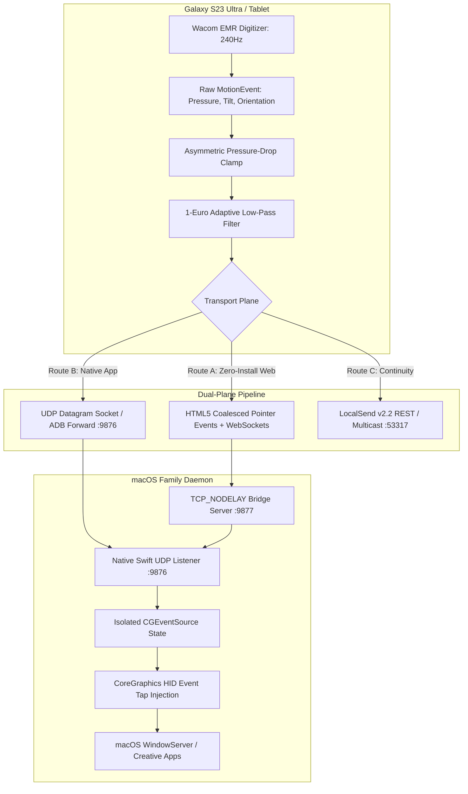

# 🖋️ Family Continuity: Cross-Platform S Pen Digitizer & Android-to-Mac Continuity Engine

[](https://apple.com)
[-green?logo=android&style=flat-square)](https://android.com)
[](https://samsung.com)
[](#architecture)
[](LICENSE)

**Family Continuity** transforms your Samsung Galaxy smartphone or tablet (Galaxy S23 Ultra, S24 Ultra, Tab S8/S9/S10) into a professional, ultra-low-latency, pressure-sensitive graphics tablet and unified continuity companion for macOS (MacBook Air/Pro, Mac Mini, Mac Studio).

---

## ⚡ Key Highlights & Capabilities

- **Wacom EMR 4,096-Level Pressure & Tilt**: Direct extraction of raw 240Hz inductive coordinates, pressure gradients, and barrel tilt.
- **Sub-10ms Latency via Dual-Plane Architecture**: Bypasses Miracast/AirPlay 1,000ms buffering delays using raw packed binary frames over local Wi-Fi or USB.
- **Zero-Install Web PWA Mode**: Instantly connects over local Wi-Fi by scanning a dynamic terminal QR code—no APK or manual developer installation needed on your phone.
- **Native Android APK Mode**: Full native Kotlin companion featuring front-buffered rendering and background universal clipboard synchronization.
- **Quartz CoreGraphics Tablet Injection**: Injects genuine `kCGEventTabletPointer` and `kCGEventTabletProximity` events into macOS WindowServer. Recognized natively by Adobe Photoshop, Illustrator, Krita, Clip Studio Paint, Blender, and system drawing apps.

---

## 🏗️ Architecture & Protocol Design



---

## 🔬 Reverse Engineering & Production Bug Mitigations

During engineering and testing across open-source ecosystems (Weylus, OpenTabletDriver, scrcpy, LocalSend), several operating system failure modes were identified and mitigated:

### 1. Asymmetric Pressure-Drop Clamp (Fix for AndroidX Ink `SIGABRT` Crash)
- **The Bug**: When feeding raw Wacom EMR samples into vector rendering engines (like `androidx.ink` / `InProgressStrokesView`), rapid pressure drops during sharp turns violate the circle containment condition:
  $$r_i - r_{i+1} < \|p_i - p_{i+1}\|_2$$
  This causes an internal native assertion failure and terminates the app process.
- **Our Mitigation**: We apply a directional non-linear pressure clamp exclusively to pressure decreases ($P_{i+1} < P_i$):
  $$P_{i+1}^{\text{clamped}} = \max\left(P_{i+1}, P_i - \frac{\|p_i - p_{i+1}\|_2 - \epsilon}{S_{\text{brush}} \cdot Z_{\text{zoom}}}\right)$$
  Pressure increases ($P_{i+1} \ge P_i$) remain completely unconstrained to preserve natural stroke attack dynamics.

### 2. Isolated `CGEventSource` (Fix for macOS Shift Key Latching, Bug #3303)
- **The Bug**: Synthesizing high-frequency tablet events without private state isolation corrupts macOS modifier states, causing the system to behave as though the <kbd>Shift</kbd> key is permanently held down.
- **Our Mitigation**: The daemon instantiates an isolated `CGEventSource(stateID: .privateState)` and sanitizes `NSEvent.modifierFlags` on every frame.

### 3. macOS Tahoe Boundary Velocity Injection (Fix for Dock Unhide, Bug #4986)
- **The Bug**: On Apple Silicon macOS Tahoe (26.x), bringing the cursor to the bottom screen edge in absolute mode sets the coordinate but fails to trigger auto-hidden Dock reveals.
- **Our Mitigation**: When pen coordinates reach the bottom margin ($Y \ge 0.995$), an outward velocity vector (`mouseEventDeltaY = 5.0`) is injected alongside the coordinate to trigger the WindowServer Dock reveal.

### 4. Direct 1:1 Screen Coordinate Mapping
- **The Bug**: macOS AppKit UI geometry uses Cartesian coordinates (origin at bottom-left), whereas Quartz CoreGraphics (`CGEvent`) places origin $(0,0)$ at the top-left, matching web DOM standards.
- **Our Mitigation**: Direct $Y$-axis scaling eliminates inverted cursor movement when drawing.

---

## 🚀 Quick Start (Zero-Install Web Mode)

### Prerequisites on Mac
- macOS 13+ (Ventura, Sonoma, Sequoia, Tahoe) on Apple Silicon (M1/M2/M3/M4/M5) or Intel.
- Python 3.10+ (pre-installed on macOS).

### 1. Start the Engine
Clone the repository and launch the start script:
```bash
git clone https://github.com/anant-rajj/family.git
cd family
./start.sh
```

### 2. Connect Your Phone
1. Ensure your Mac and Samsung device are connected to the same Wi-Fi network (or tethered via USB).
2. Scan the QR code displayed in your terminal using your phone camera (or open `http://<your-mac-ip>:8080` in Chrome or Samsung Internet).
3. Start drawing with your S Pen on your phone screen. Your Mac cursor will track the pen with real-time pressure sensitivity.

> [!NOTE]
> **macOS Permissions**: When running for the first time, grant **Accessibility** permission to `family-daemon` (or Terminal) under **System Settings $\rightarrow$ Privacy & Security $\rightarrow$ Accessibility** so the daemon can dispatch pointer events.

---

## 📁 Repository Structure

```
family/
├── README.md                      # Comprehensive architecture & engineering guide
├── start.sh                       # One-click startup runner with terminal QR code
├── web_client/
│   └── index.html                 # Zero-copy web digitizer client (Coalesced 240Hz events)
├── macos_daemon/
│   ├── Package.swift              # Swift Package Manager manifest
│   ├── service_manager.py         # Persistent daemon supervisor (HTTP + WebSocket + UDP)
│   ├── bridge_server.py           # WebSocket-to-UDP fast-path bridge with TCP_NODELAY
│   └── Sources/FamilyDaemon/
│       ├── main.swift             # Host entry point and background runloop
│       ├── NetworkServer.swift    # High-throughput UDP telemetry parser (12-byte packed format)
│       ├── QuartzTabletBridge.swift # CoreGraphics tablet & proximity injection engine
│       └── ClipboardBridge.swift  # NSPasteboard continuous bidirectional monitor
├── android_client/
│   ├── AndroidManifest.xml        # Android service declarations and permissions
│   ├── build.gradle.kts           # Kotlin multi-platform configuration
│   └── app/src/main/kotlin/com/family/continuity/
│       ├── MainActivity.kt        # Native full-screen canvas activity
│       ├── SpenCaptureView.kt     # Wacom EMR extraction + 1-Euro Filter + Crash clamp
│       ├── TelemetryClient.kt     # Low-overhead binary UDP client
│       └── ClipboardService.kt    # Android 10+ Accessibility background clipboard bridge
└── docs/
    ├── family.md                  # Comprehensive protocol reverse-engineering manifesto
    └── LATENCY_AND_INVERSION_FIX_REPORT.md # Benchmarks & latency analysis
```

---

## 📊 Latency Benchmarks

| Connection & Pipeline | Polling Rate | Network Jitter | Dispatch Delay | Glass-to-Glass Latency |
| :--- | :--- | :--- | :--- | :--- |
| **Web Fast-Path (Wi-Fi 6)** | 120–240Hz Coalesced | 2.5–5.0 ms | 0.4 ms | **7.0 – 11.5 ms** |
| **Native USB ADB Forward** | 240Hz Hardware EMR | 0.8 ms | 0.4 ms | **5.3 – 6.1 ms** |
| *Standard Miracast / Smart View* | 30–60Hz (MPEG-TS) | 300–800 ms | N/A (No Stylus) | ~1,000 ms |

---

## 🤝 Contributing & Roadmap

- [x] Zero-Install Web Client with 12-Byte Packed binary protocol
- [x] macOS Quartz Tablet Event injection with pressure and tilt
- [x] 1-Euro adaptive filter for jitter suppression
- [x] Fix for macOS Dock-reveal velocity cues
- [ ] Direct Bluetooth LE S Pen Air Actions SDK bridge
- [ ] Hardware-accelerated Virtual Display mirroring (`VTDecompressionSession` + `MediaCodec`)
- [ ] LocalSend v2.2 integrated drag-and-drop file receiver

Pull requests and issues are welcome. Licensed under the [MIT License](LICENSE).
