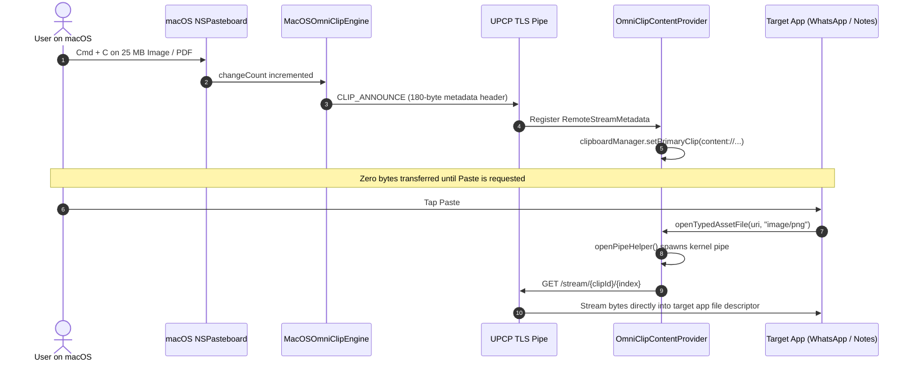

# Universal Polymorphic Clipboard Protocol (UPCP) & OmniClip Engine Specification

> **Architectural Paper & Implementation Manifest**  
> **Target Subsystems**: Android `ContentProvider.PipeDataWriter` $\longleftrightarrow$ macOS `NSPasteboardItemDataProvider`  
> **Status**: Merged into Core Architecture  

---

## 1. Abstract & System Mechanics

Operating system clipboards are fundamentally asymmetric:
- **macOS (`NSPasteboard`)**: Multi-representation key-value store indexed by UTIs (`public.utf8-plain-text`, `public.html`, `public.png`, `public.file-url`), capable of lazy `NSPasteboardItemDataProvider` promise resolution.
- **Android (`ClipboardManager`)**: Strict Binder transaction IPC limits (~1 MB ceiling). Raw file bitmaps or large blobs cannot be placed in `ClipData`. Rich content must be represented via `content://` URIs backed by a `ContentProvider` implementing `openPipeHelper`.

UPCP resolves this asymmetry by combining Android's kernel pipe streaming with macOS's lazy pasteboard promises into a single **Lazy-Evaluated Zero-Disk Pipe**.

---

## 2. Polymorphic Data Mapping Matrix

| Category | Android Source | UPCP Wire Representation | macOS Target | Android Target |
| :--- | :--- | :--- | :--- | :--- |
| **Plain Text** | `item.text` | Inline UTF-8 (<64 KB) | `public.utf8-plain-text` | `ClipData.newPlainText` |
| **Rich HTML** | `item.htmlText` + fallback | Dual Inline Payload | `public.html` + `.string` | `ClipData.newHtmlText` |
| **Bitmaps / Screenshots** | `item.uri` (`content://...`) | Lazy Stream Token | `public.png` / `public.tiff` | `ClipData.newUri` (Virtual Pipe) |
| **Files & Directories** | Multi-item `ClipData.Item` | Multi-Item Stream Manifest | `public.file-url` | Multi-item `ClipData` |

---

## 3. Security & Hazard Defenses

1. **Android 13+ Password Protection**:
   Checks `ClipDescription.EXTRA_IS_SENSITIVE`. Passwords from 1Password, Bitwarden, or Samsung Pass are dropped immediately and never broadcast.
2. **macOS Concealed Type Protection**:
   Detects `org.nspasteboard.ConcealedType`. Keychain and password manager copies are omitted.
3. **CVE-2025-27142 Path Traversal Sanitization**:
   All incoming filenames strip directory sequences (`../` or `..\`) and collapse to base names before staging.
4. **Zero Bufferbloat**:
   Announcements transmit ~200 bytes. Multi-gigabyte video or asset copies do not consume RAM or radio time until explicitly requested.
