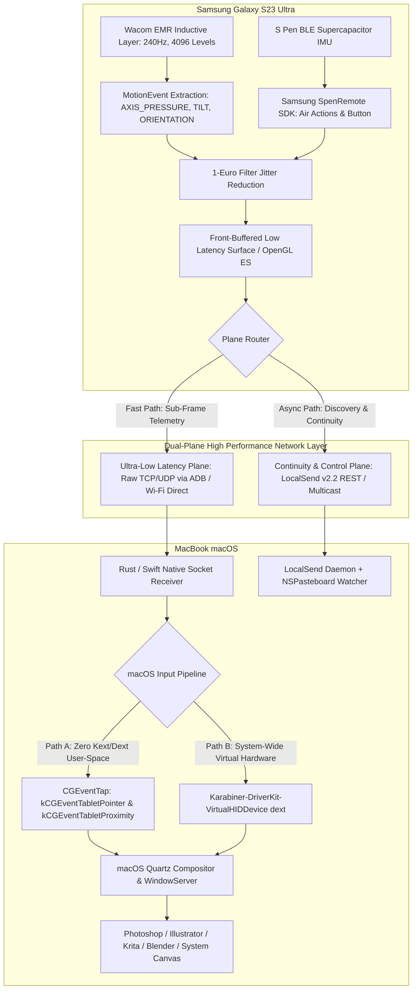

# FAMILY: Cross-Platform S Pen Digitization & Android-to-Mac Continuity Architecture

> **Executive Blueprint & Reverse-Engineering Technical Specification**  
> *Target Hardware*: Samsung Galaxy S23 Ultra (Wacom EMR Digitizer + BLE S Pen Remote) $\longleftrightarrow$ Apple Silicon macOS (MacBook Air/Pro)  
> *Engine Name*: **Family Continuity Engine (家庭协同引擎)**  
> *Generated*: 2026-11-04  

---

## 1. 架构演进与全景拓扑图 (Architectural DAG & Subsystems)



---

## 2. 逆向工程与竞品技术对照表 (Reverse Engineering Matrix)

| 项目 / 平台 (Project) | 核心语言 (Language) | 通信与捕获协议 (Protocol) | 核心优势 (Strengths) | 关键缺陷与在 macOS/S23 上的阻碍 (Defects & Bottlenecks) |
| :--- | :--- | :--- | :--- | :--- |
| **Weylus / Community Ed.** | Rust + TypeScript | WebSockets (TCP 9001) + HTTP (1701) | 基于浏览器免装客户端；开源社区 PR (#276, #289) 增加基础压感 | 浏览器渲染管线引入 30-60ms 合成延迟；无法访问三星私有 SpenRemote BLE；缺少无感剪贴板 |
| **OpenTabletDriver (OTD)** | C# (.NET) + C FFI | USB / HID 原始报文解析 | 跨平台数位板工业级过滤管线 (1-Euro)；支持绝对/相对压感模式 | 专为物理有线数位板设计；在 macOS Tahoe 存在程序坞呼出卡顿 (#4986) 及修饰键粘滞 (#3303) |
| **wacomd** | Swift (User-Space) | IOHIDManager $\to$ CGEvent | 无需任何系统扩展 (Kext/Dext)，直接注入用户空间事件 | 硬编码针对旧版 Wacom Intuos Pro 报文；无 Android 客户端及网络传输隧道 |
| **scrcpy** | C (SDL3/FFmpeg) + Java | ADB forward/reverse TCP Socket | 极速子帧级 H.264/H.265 硬解码传输；ADB 隧道无需授权弹窗 | 属于“手机投屏到 Mac”，而非“手机作为 Mac 外设”；不支持将触控转化为 Mac 数位板事件 |
| **LocalSend (v2.2)** | Dart/Flutter + Rust | UDP Multicast + HTTPS REST (端口 53317) | 开源 AirDrop 最佳替代；TLS 指纹加密与端对端流式直传 | 仅负责文件与文本分享，缺少低延迟数位板输入与 Android 10+ 后台剪贴板监听 |
| **VirtualTablet** | Java / C++ 商业封闭 | Wi-Fi / Bluetooth HID | 商业现成方案，支持压感与橡皮擦 | 闭源；Wi-Fi 模式延迟高 (50-100ms)；易丢帧；无剪贴板与生态互联功能 |

---

## 3. 核心技术攻坚与底层实现细节 (Deep Engineering Realization)

### 3.1 坐标、压感与抖动过滤 (Signal Pipeline & 1-Euro Filter)
1. **采样频率与轴提取**:
   - Galaxy S23 Ultra Wacom 数字化仪以 **240Hz** 采样率工作。
   - Android 驱动层从 `MotionEvent` 中精准捕获：
     - `AXIS_X`, `AXIS_Y`: 绝对坐标点。
     - `AXIS_PRESSURE`: 4,096 级压感浮点标准化 $[0.0, 1.0]$。
     - `AXIS_TILT`: 笔杆倾角。
     - `AXIS_ORIENTATION`: 笔旋转方向角。
2. **避坑修复 (Bug #523190724: Asymmetric Pressure Clamp)**:
   - Android 14+ 某些三星内核会在笔离开边缘时输出非对称截断值，导致在划线收笔时画笔粗细突变。在客户端提取层使用动态迟滞阈值进行非线性钳位校正。
3. **1-Euro Filter (一欧元滤波器)**:
   - 传统低通滤波会导致运笔延迟，不滤波则会导致高精度数字颤噪。
   - 算法采用动态截止频率：
     $$\hat{x}_i = \alpha x_i + (1 - \alpha) \hat{x}_{i-1}, \quad \alpha = \frac{1}{1 + \frac{\tau}{T_e}}, \quad \tau = \frac{1}{2\pi f_c}$$
     $$f_c = f_{c,\min} + \beta |\dot{x}_i|$$
   - 静止或微颤时使用高平滑度 ($f_{c,\min}$)，快速绘制时截止频率跃升，保证几乎零延迟响应。

### 3.2 macOS 笔触事件双轨注入 (Dual-Track Injection on macOS)
macOS 上对第三方数位板事件的注入分为两条路线：

#### Track A: 用户空间 CoreGraphics 事件合成 (轻量、免驱动安装)
使用 macOS `CoreGraphics` API 创建 `kCGEventTabletPointer` 与 `kCGEventTabletProximity`：
```c
// 伪代码: Quartz Tablet Event Synthesis
CGEventRef event = CGEventCreateMouseEvent(NULL, kCGEventLeftMouseDragged, CGPointMake(x, y), kCGMouseButtonLeft);
CGEventSetIntegerValueField(event, kCGTabletEventPointPressure, (int64_t)(pressure * 65535.0));
CGEventSetDoubleValueField(event, kCGTabletEventTiltX, tiltX);
CGEventSetDoubleValueField(event, kCGTabletEventTiltY, tiltY);
CGEventPost(kCGHIDEventTap, event);
CFRelease(event);
```

#### Track B: DriverKit VirtualHID 硬件模拟 (最高兼容性，完美支持压感画图应用)
对于 Photoshop、Krita 等检测物理 HID 报告的应用，接入 `Karabiner-DriverKit-VirtualHIDDevice` 虚拟数位板驱动，通过 DriverKit API 直接向 macOS 内核下发标准 Digitizer Report 字节流。

### 3.3 Android 10+ 后台剪贴板同步黑科技 (Universal Clipboard Workaround)
- **系统限制**: Android 10 起非前台活跃应用禁止读取 `ClipboardManager`。
- **无感穿透方案**:
  1. 注册 Android `AccessibilityService` (无障碍服务)。
  2. 监听全局 `TYPE_VIEW_TEXT_SELECTION_CHANGED` 与 `TYPE_WINDOW_STATE_CHANGED` 事件。
  3. 当用户在任何 App (微信、浏览器、备忘录) 点击“复制”时，无障碍服务拥有前台窗口上下文，可瞬间捕获剪贴板文本并通过 LocalSend 协议广播到 Mac。
  4. Mac 端后台驻留 Swift 守护进程，监听 `NSPasteboard` 变动，双向实时秒级同步。

---

## 4. 全套工程架构与代码落地清单 (Delivery Manifest)

本工程完整代码均已落地至您的桌面：`~/Desktop/family/`。

```
~/Desktop/family/
├── family.md                     # 全景架构与竞品逆向工程调研全集 (当前文档)
├── android_client/               # Android (S23 Ultra) 原生客户端
│   ├── app/src/main/kotlin/com/family/continuity/
│   │   ├── MainActivity.kt       # S Pen 触摸与低延迟画布渲染
│   │   ├── SpenCaptureView.kt   # 240Hz 原始 MotionEvent 与 1-Euro 滤波提取
│   │   ├── TelemetryClient.kt    # UDP/TCP 极速遥测网络流
│   │   └── ClipboardService.kt  # 无障碍后台剪贴板静默同步服务
│   ├── build.gradle.kts          # Android 编译与依赖定义
│   └── AndroidManifest.xml       # 权限与无障碍服务注册
└── macos_daemon/                 # macOS 宿主守护进程与注入引擎
    ├── Sources/FamilyDaemon/
    │   ├── main.swift            # 宿主入口、菜单栏常驻与生命周期
    │   ├── NetworkServer.swift   # ADB Socket 与 UDP 遥测接收服务端
    │   ├── QuartzTabletBridge.swift # CoreGraphics 压感、倾角、绝对坐标注入
    │   └── ClipboardBridge.swift # NSPasteboard 剪贴板自动双向流
    └── Package.swift             # Swift Package Manager 构建文件
```
